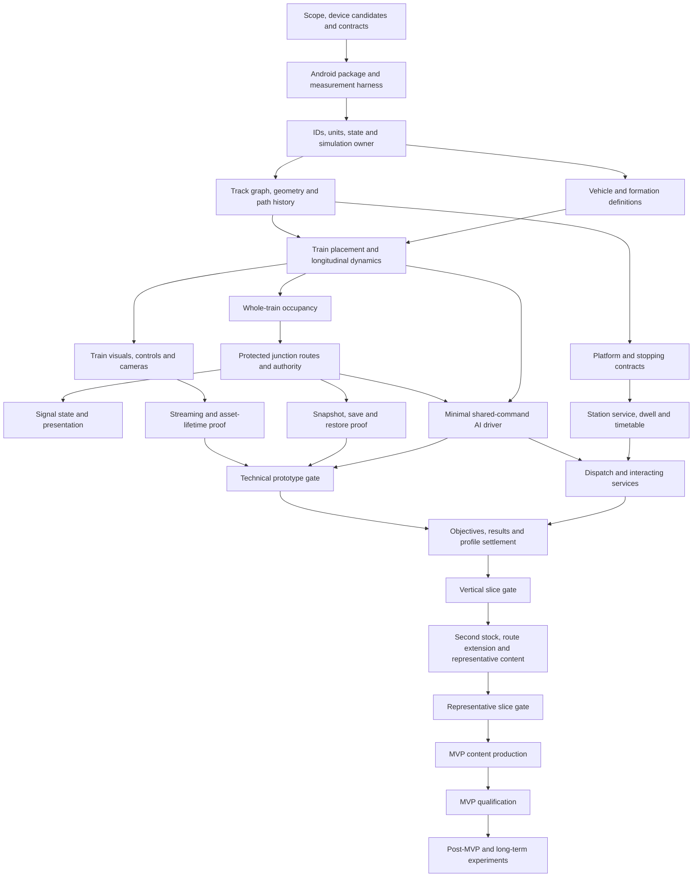

# Indian Railway — Implementation Roadmap

Status: proposed build order and acceptance gates; no implementation authorized or performed by this document. Prepared 18 September 2026 from `ARCHITECTURE_REVIEW_AND_BLUEPRINT.md` and the user's roadmap request. The master brief, blueprint and Unreal project remain unchanged.

Current workspace evidence: the existing project is `03_UnrealProject/MyProject/MyProject.uproject`; no `Source/` directory or game module declaration was found. Its configuration selects Desktop/Maximum hardware defaults and the engine OpenWorld template as its default map. The previously inspected editor log reports UE 5.8.2. These observations do not establish Android compatibility or any implemented railway functionality.

**Build first:** a minimal packaged Android measurement harness in the existing project. **Build second:** the actor-independent track-position/path kernel, with a simple multi-vehicle visual follower. Add dynamics and braking next, then occupancy and protected junction movement. Do not begin with a detailed locomotive, finished route, career system, or a large hierarchy of managers.

All counts, tolerances, rates and budgets below are proposed acceptance settings, not measurements. Agree test envelopes before running experiments; do not relax them silently to obtain a pass. There are no calendar deadlines.

## A. Complete dependency graph

### A1. How to read the graph

The graph describes **build dependencies**, not every runtime message. A producer's contract must exist before its consumer can be integrated; independent work may use a recorded fixture. The authoritative adjacency table below is the complete major-system graph. The diagram summarizes its critical paths.

At runtime, drivers, dynamics and operations form a feedback loop. That does not require circular class ownership. A single simulation owner executes the loop in explicit phases, described in D. Initial inputs are supplied by test fixtures before the full producer exists.

### A2. Complete major-system dependency register

Every dependency ID refers to another row. Dependencies are prerequisites for the first useful integrated version, not a requirement to finish the producer's long-term scope. Acceptance tests and device measurement apply continuously, including when not repeated in each row.

| ID | Major system(s) and owned result | Direct prerequisites | First useful delivery |
|---|---|---|---|
| D00 | Product boundaries, device candidates, authority/units/identity contracts | None | S0 decisions |
| D01 | Android packaging, build configuration, device diagnostics | D00 | S1 harness |
| D02 | Core state records, IDs, simulation clock/update owner | D01 | S2 kernel |
| D03 | Track geometry, edges, connectivity, network and train paths | D02 | S2 kernel |
| D04 | Locomotive, coach/wagon definitions and formation instances | D02 | S2 kernel |
| D05 | Train pose, wheel/axle/bogie placement and path history | D03, D04 | S2 kernel |
| D06 | Shared command arbitration, traction, brakes, train dynamics | D02, D03, D04 | S3 handling |
| D07 | Player train assignment, input/touch adapter and minimal controls | D06 | S3 handling |
| D08 | Train presentation, basic camera and read-only debug HUD | D05, D06 | S3 handling; geometric view begins in S2 |
| D09 | Whole-train block/detection occupancy and swept crossings | D03, D05, D06 | S4 protection |
| D10 | Junction/point state, route conflicts, locks and movement authority | D09 | S4 protection |
| D11 | Signal rules/state and signal presentation | D10 | S4 protection |
| D12 | AI driver using shared commands and authority | D06, D10, D11 | S5 interaction proof |
| D13 | Platforms, station stop markers and berth evaluation | D03, D04, D06 | Marker fixture S3; service version S7 |
| D14 | Timetable/service readiness and station dwell/operations | D02, D13 | S7 vertical slice |
| D15 | Dispatch, priorities, traffic conflicts and wait reasons | D10, D12, D14 | Simple request ordering S5; service version S7 |
| D16 | Relevance tiers/background train scheduling | D12, D15 | Visual relevance S6; logical aggregation only after measured need |
| D17 | Asset catalog, bundle loading/lifetime and content availability | D01, D04 | Minimal bundle proof S6; catalog S8 |
| D18 | World streaming/loading and train-actor binding | D03, D08, D17 | S6 continuity |
| D19 | Save snapshots, restore validation and app lifecycle/offline resume | D02, D06, D10 | In-memory snapshot S3; complete prototype persistence S6 |
| D20 | Mission/scenario objectives, violations and session outcomes | D11, D13, D14, D15 | S7 vertical slice |
| D21 | Progression, career, statistics, achievements, rewards/economy settlement | D19, D20 | Minimal reputation/unlock transaction S7; career S9 |
| D22 | Full front end/HUD/results/settings/input preference UI | D07, D08, D17, D19, D20 | End-to-end thin UI S7; representative polish S8 |
| D23 | Tutorial/onboarding and assistance/difficulty | D07, D20, D22 | S7–S8 |
| D24 | Cab layout, interactive instruments, production camera profiles | D04, D07, D08 | S8 representative slice |
| D25 | Audio framework and Indian railway sound profiles | D06, D08, D14, D17 | Parameter/voice sample S7; distinctive stock/station audio S8 |
| D26 | Passenger demand/capacity and boarding counts | D04, D13, D14 | S8 bounded counts |
| D27 | Station activity, workers, local NPC visuals and animation | D18, D25, D26 | S8 representative station |
| D28 | Weather conditions and visual presets | D02, D06, D18 | Adhesion fixture S3; coherent dry/rain S8 |
| D29 | Time-of-day environment lighting | D02, D18 | Static baseline S1; day/night presets S8 |
| D30 | Regional world/environment, terrain, infrastructure, LOD/HLOD/instancing/material/VFX production | D03, D17, D18, D28, D29 | Cost proxies S6; representative kit S8 |
| D31 | Device profiles, graphics settings, performance/memory/thermal adaptation | D01, D08, D18 | Instrumentation S1; measured tiers/adaptation S8 |
| D32 | Accessibility/localization and persistent preferences | D07, D22 | Input/text contracts S3; actual localized screens S7–S8 |
| D33 | Content/data authoring, validators and editor tools | D03, D04 | Test-fixture validation S2; editor tools only as needed S4–S8 |
| D34 | Test/repro/telemetry/debug tooling | D01, D02 | Measurement S1, invariant/event tools S2; remote telemetry optional later |
| D35 | Freight cargo/load and player freight missions | D04, D06, D14, D20 | AI freight data S9; player operations post-MVP |
| D36 | Shunting, reversal tasks and runtime coupling/formation changes | D05, D09, D10, D12, D35 | Post-MVP; test reversal geometry earlier |
| D37 | Monetization/entitlement/store adapters | D17, D19, D21, D22 | Only after business policy and explicit integration scope |
| D38 | Cloud save, online achievements/leaderboards/live events | D19, D21, D34 | Post-MVP product decision; offline base has no dependency on this |
| D39 | Advanced rule packs and realistic regional railway operations | D10, D11, D14, D15, D33 | New reviewed experiments after chosen MVP subset |
| D40 | Multi-region large-network simulation and hierarchical dispatch | D03, D16, D17, D18, D19, D39 | Long-term; measured region-scale need first |
| D41 | Scenario/route creator and generation | D20, D30, D33, D39 | Long-term; mature internal tools first |
| D42 | Multiplayer | D02, D06, D10, D19 plus a new product/authority specification | Separate future feasibility project; existing boundaries do not guarantee easy replication |

The graph deliberately avoids dependencies such as “physics requires a finished weather system”: physics consumes an adhesion/condition contract populated by a fixed fixture first. Likewise, snapshot design starts with train state and expands as operations arrive; it does not wait for a career system.

### A3. Absolute minimum foundation

Before the first controllable driving experiment, only these foundations are necessary:

1. A project that packages, launches and reports diagnostics on a named Android device.
2. Stable IDs, units, direction conventions and one owner of mutable simulation state.
3. A small valid track graph with arc-length sampling and track position/path history.
4. One powered-vehicle definition, one reusable trailer definition and an ordered formation.
5. A longitudinal motion/command model with actual coasting and braking.
6. A thin visible representation, one camera, touch input and speed/control feedback.

Occupancy and authority are not prerequisites to a lone train moving on an isolated test track. They **are mandatory before the technical prototype passes**, because movement alone does not test the project's central architecture. Career, timetable, crowd, weather presentation, production cab and finished scenery are unnecessary foundations.

### A4. Independently developable work

| Work stream | Earliest start/required contract | Independent output | Integration condition |
|---|---|---|---|
| Track math tests | Units/position/edge contracts | Geometry and traversal fixtures | Uses the production path API, not a parallel path implementation |
| Dynamics calibration | Definition and command contracts | Reference curves, stopping tests | Consumes the same gradient/adhesion inputs as real routes |
| Touch/UX experiments | Semantic commands and snapshot shape | Wireframes and real-phone layout mock | Must drive actual controls before claiming stopping usability |
| Audio research and sample graph | Telemetry names/ranges | Rights register, class samples and parameter prototype | Measure on device with real train telemetry before final banks |
| Asset standards/references | Region/stock candidates and budget hypothesis | Pivot/socket/material/LOD specifications | No volume production before S8 gate |
| Snapshot serialization tests | Versioned logical records | Corruption/migration fixtures | Restore complete operational state once D10 exists |
| Scoring/progression design | Event and result contract | Example result evaluations and unlock graph | Integrate only after real scenario events and settlement recovery work |
| Localization/accessibility preparation | Stable text keys and UI vocabulary | Font/text-expansion fixtures and cue rules | Test in actual target screens before sign-off |

Do not independently implement multiple mutable versions of a train, signal or timetable. Shared ownership and schemas are prerequisites to safe parallel work.

## B. Implementation stages

**Technical Prototype → Vertical Slice → Representative Slice → MVP Production → Post-MVP → Long-Term Vision.**

The earlier blueprint grouped much of the slice work together. This roadmap separates it: the **vertical slice proves a complete player loop**, and the **representative slice proves that the intended content quality, variety, production method and Android costs are repeatable**. Neither substitutes for the complete MVP scope.

### S0 — Establish decisions and experiment records

- **Objective:** make the first build unambiguous without trying to finalize the whole game.
- **Systems:** project governance, device/toolchain inventory, conceptual contracts, test evidence.
- **Dependencies / already exists:** master brief and architecture blueprint; access to at least one Android device or an explicitly recorded device-access blocker.
- **Produce:** selected first device, intended floor/reference candidates, engine/toolchain record, O's foundational decisions, experiment IDs and agreed test envelopes.
- **Test:** inspect whether each forthcoming experiment has a question, fixture, observable result and pass/fail condition.
- **Exit:** no unknown prevents creating the harness or interpreting its result; unresolved production choices are assigned to experiments in L.
- **Major risks:** endless planning, treating proposals as confirmed facts, choosing a device floor by RAM alone.

### S1 — Packaged Android measurement harness

- **Objective:** verify that this project and toolchain can build, install, launch and be measured on Android.
- **Systems:** minimal map, mobile configuration, packaging, lifecycle logging, CPU/GPU/memory/frame diagnostics.
- **Dependencies / already exists:** S0 and a clean baseline/backup of the current project; no railway classes needed.
- **Produce:** a tiny local packaged build, device/build manifest and baseline trace. Start from the existing project; do not create a second game project to evade configuration problems.
- **Test:** cold/warm launches, offline launch, input response, background/foreground, log retrieval and a short sustained run.
- **Exit:** repeatable installation/launch on the named device; measurement pipeline works; engine/toolchain incompatibilities are resolved; current desktop settings are deliberately reviewed rather than inherited blindly.
- **Major risks:** treating successful editor play as Android evidence; adding unrelated plugins; empty-map fps mistaken for future game performance.

### S2 — Track, formation and placement kernel

- **Objective:** prove the coordinate model and long-train geometry before detailed physics or artwork.
- **Systems:** simulation owner, IDs, edge/path records, track sampler, vehicle/formation definitions, bogie/body placement, test fixtures.
- **Dependencies / already exists:** S1; locked units, direction, ID and ownership contracts.
- **Produce:** a validated small graph, one locomotive/trailer proxy formation, debug traversal forward/backward and invariant reports.
- **Test:** straight, curve, grade, edge boundaries, Y junction, reversed travel, different lengths and a train spanning several edges.
- **Exit:** no path loss or switch divergence; signed movement and rear placement agree; invalid topology/definitions are rejected. S2 can use commanded distance advance without pretending it is final dynamics.
- **Major risks:** spline actors becoming authoritative; nearest-spline projection replacing traversal history; zero-length edges or unit errors.

### S3 — Controllable longitudinal train

- **Objective:** establish actual throttle/coast/brake behavior and basic phone control.
- **Systems:** force model, actuators/brake lag, fixed-step update, command ownership, input adapter, camera/HUD, stop-target fixture, in-memory snapshot.
- **Dependencies / already exists:** S2 path/formation and basic visual binding.
- **Produce:** one playable handling test with short/long/heavy configurations and a fixed stop marker; reference measurements and first state snapshot round trip.
- **Test:** level/gradient acceleration, coasting, emergency/service braking, adhesion variation, stationary holding/rollback policy, touch cancellation, render-rate variation.
- **Exit:** numerical tests in D pass; the same command trace behaves consistently within tolerance; players can control speed and stop using the phone. No physical-accuracy claim without reference data.
- **Major risks:** instant braking, hidden speed setting, arbitrary damping, touch gestures masking poor physics.

### S4 — Occupancy, protected junction and signal state

- **Objective:** prove that moving trains cannot be given conflicting protected routes.
- **Systems:** swept whole-train footprint, block occupancy, point/route locks, route grant/release, authority endpoint, basic signal policy, inspector.
- **Dependencies / already exists:** S3 movement, S2 path history, route/conflict fixture.
- **Produce:** two competing route requests through a shared section; debug signal/authority display; rule-invariant suite.
- **Test:** simultaneous requests, front/rear clearance, long train, direction changes, request cancellation, missing data, frame hitch and point-change attempts.
- **Exit:** zero conflicting grants in the defined exhaustive fixture cases; locks survive actor removal; release occurs only at valid rear-clearance conditions.
- **Major risks:** occupancy conflated with reservation; signal color granting authority; stale footprint allowing a point to change.

### S5 — Minimal AI interaction proof

- **Objective:** show a second train obeying the same railway truth and dynamics.
- **Systems:** small brake-to-target AI driver, shared commands, fixed path, deterministic request ordering and wait reason.
- **Dependencies / already exists:** S4 protected movement and S3 calibrated provisional braking model.
- **Produce:** one AI train using the same stock data, plus a reproducible player/AI conflicting movement; no timetable planner.
- **Test:** approach to held authority, grant and restart, repeated conflict resolution, wet/heavy fixture, disabled AI visual actor and emergency stop.
- **Exit:** AI never relies on a collision trigger or direct velocity assignment; it obeys authority and makes progress in the feasible fixture; actor visibility cannot change its route permissions.
- **Major risks:** writing a full traffic system prematurely; driver overshoot hidden by teleportation; treating always-active logic as demonstrated background aggregation.

### S6 — Streaming, memory and persistent recovery; technical prototype gate

- **Objective:** validate actor-independent state during real asset/level unload and mobile interruption.
- **Systems:** two presentation chunks, asset lifetime handles, visual activation, snapshot serialization/recovery, lifecycle hooks, packaged stress capture.
- **Dependencies / already exists:** S2–S5 integrated; stable snapshot includes operations and both trains; explicit content manifest for the fixture.
- **Produce:** completed technical prototype, force-unload test, interrupted-save reports, measured load/memory traces and updated risk decisions.
- **Test:** cross chunk boundary with train spanning it, remove/recreate signal/train views, reverse camera, kill app, corrupt newest checkpoint, restart offline, fixed-cost proxy load and sustained run.
- **Exit:** all required C/D prototype gates pass. Unproven representative art cost is explicitly carried into S8; no missing core-state invariant is deferred to content production.
- **Major risks:** logical state lives in streamed actors; incorrect restored locks; mass activation spikes; simple proxy scene misrepresented as a performance proof for finished art.

### S7 — Vertical slice: complete player loop

- **Objective:** prove that the foundation supports an understandable, enjoyable, resumable service.
- **Systems:** one service itinerary, a functional station/berth/dwell, minimal timetable/dispatch, objective evaluation, result, one unlock/reputation transaction, lightweight menus/tutorial, early audio.
- **Dependencies / already exists:** technical prototype passes; stop/failure/assist/scoring semantics fixed for the slice.
- **Produce:** a complete service-selection → drive → traffic response → station service → result → reward → replay/continue loop.
- **Test:** observe casual and enthusiast players, inject a legitimate signal hold, fail/retry, resume mid-service, repeat result settlement after interruption, play entirely offline.
- **Exit:** E's gates pass; traffic-caused delays are explained/scored fairly; progression cannot duplicate settlement or require network access.
- **Major risks:** polishing only driving while menus/recovery are broken; using scripted visual traffic instead of the rail model.

### S8 — Representative slice: production method and cost proof

- **Objective:** prove repeatable quality, variety and sustainable Android cost before volume production.
- **Systems:** second distinct stock configuration, production-representative cab/exterior/audio, busy station kit and quieter stretch, route extension, night/rain, bounded people, LOD/material/streaming bundles, localization/accessibility, tiers.
- **Dependencies / already exists:** S7 full loop; rights-cleared sample sources, tentative stock/region choice and authoring budget.
- **Produce:** finished-quality samples, second-content addition report, measured device matrix, asset standards, accepted rendering/streaming decisions and frozen candidate MVP scope.
- **Test:** combine player long consist, interacting trains, busy station, night/rain and camera changes; compare first and second content authoring steps; migrate an old slice save across a compatible content change.
- **Exit:** F/G pass. No core architectural fork for ordinary content variants; worst-case device evidence supports the intended content envelope.
- **Major risks:** sampling only the cheap rural daytime scene; accepting a second train that is only a recolor; hidden manual authoring steps that cannot scale.

### S9 — MVP production and qualification

- **Objective:** deliver the blueprint's approved player-ready coverage through the proven pipeline.
- **Systems:** two-corridor candidate network, station-role coverage, stock/formation variety, AI freight, missions/career, audio/UI/tutorial, save/offline, validated tiers and release packaging.
- **Dependencies / already exists:** G's production-entry gate signed off; measured budgets and content scope frozen with change control.
- **Produce:** complete candidate MVP plus build, content, save, device, rights and acceptance reports.
- **Test:** validators on every addition, all scenario paths/assistance modes, progression completion, seed suite, device soak, cold loads, storage failures and release-build differences.
- **Exit:** blueprint R01–R14 and Section N gates pass; no critical crash, corruption, unsafe conflicting authority, progression block or core offline failure.
- **Major risks:** scope creep, copied per-stock gameplay logic, final-pass-only optimization, qualification based on average fps.

### S10 — Post-MVP expansion and long-term feasibility

- **Objective:** add demonstrated value without destabilizing the released foundation.
- **Systems:** separately scoped player freight, shunting, richer rules/weather/regions; later creator/network/multiplayer experiments only if selected.
- **Dependencies / already exists:** stable MVP, demand/evidence, saved-game compatibility baseline and budget for the extension.
- **Produce:** one extension specification/experiment at a time, migration and regression evidence.
- **Test:** extension-specific risk proof plus existing scenario/save/device suite.
- **Exit:** each extension has its own verified feature and compatibility gates; the long-term vision is not a single giant implementation stage.
- **Major risks:** treating every aspirational feature as committed work; a regional extension forcing global always-active simulation.

## C. First technical prototype

### C1. Question and deliberate limits

**Can a multi-vehicle train move correctly on an explicit graph, share protected infrastructure with one other train, and preserve logical state when Android presentation unloads or the app is interrupted?**

Build it incrementally through S1–S6. The first runnable increment is only the Android harness; the first controllable increment is S3; the completed technical prototype is S6. Do not attempt to create its whole final test surface at once.

This narrows the earlier blueprint's prototype fixture: one minimal AI train is sufficient for the first two-way conflict proof; richer multi-train dispatch belongs to the slices. Test data can make additional conflicting requests without creating a fleet or complete timetable.

| Candidate item | Decision | Smallest implementation that answers the question |
|---|---|---|
| One locomotive | Include as a definition and primitive visual proxy | One powered capability with tunable traction; no authentic finished class, cab or livery required |
| One formation | Include one reusable authored formation, with generated short/long/load test variants | Powered vehicle plus repeated trailer definition; enough length to span a junction and multiple sections |
| Small track graph | Include | Two approaches converge through one protected junction into a shared exit; include straight, curve and grade samples without kilometer-scale scenery |
| Train movement | Include | Edge-distance traversal and recorded transition history |
| Train physics | Include minimum longitudinal model | Mass, traction curve, resistance, signed grade, brake lag and adhesion parameter |
| Speed control | Include throttle/coast/brake commands | No tap-to-set-velocity and no production cruise-control feature |
| Braking | Include | Service/emergency application, lag, stable stop and conservative stopping prediction |
| Track position | Include first, before physics | Stable edge ID, along-edge distance and direction independent of world actors |
| Basic signal | Include logical state/debug symbol; defer a production signal asset | Displays authority policy; never owns permissions |
| Basic block occupancy | Include | Train footprint across edge intervals and swept crossings; no axle-counter hardware simulation |
| Basic junction | Include | Explicit legal transitions and conflicting resources, locked until rear clear |
| Basic AI train | Include late, S5 | One deterministic driver using existing commands, a fixed path and authority stop target; no timetable AI/Behavior Tree framework |
| Basic station stop | Exclude station system; include a stop-target test marker | A position/speed tolerance proves braking accuracy; platforms, passenger dwell and station service wait for S7 |
| Basic camera | Include one chase camera with controlled offset | Debug lookback allowed for streaming tests; no finished cab or cinematic system |
| Basic UI | Include | Speed, controls, edge/distance, authority distance, aspect/hold reason and pause/resume; no frontend career UI |
| Android packaging | Include first | Every integrated milestone remains packageable and is exercised on a named device |
| Streaming | Include late, S6 | Two presentation chunks and forced train/signal actor unload; fixed geometry/asset load proxies |
| Save/resume | Include late, with state design earlier | Versioned snapshot of both trains and operations; cold process restart offline; no cloud/profile economy |
| Audio/weather/crowds | Exclude finished systems | Optional single feedback sound; adhesion fixture without rain rendering; crowds represented only by cost proxies when testing load |

Track and segment lengths must be selected from formation length, stopping distance and test speed so that approaches can actually stop. An attractive miniature Y junction with insufficient braking distance is an invalid fixture.

### C2. Prototype completion evidence

Keep a manifest containing build/device IDs, definitions, graph version, command traces, seed, test tolerances and outcomes. Include CPU/GPU/frame/memory traces and reproducible failures. Passing means the required contracts and continuity tests work in the packaged app, not simply that a video looks convincing.

No content count in this prototype changes the MVP scope. Its single powered definition, simple graph and primitive geometry are instruments for testing architecture.

## D. Prototype test plan

### D1. Minimum simulation update model

Start with one game-thread simulation owner. Use a fixed **30 Hz candidate step**, an accumulator independent of render fps, and interpolation for visible transforms. Compare to a 60 Hz reference run as a convergence test before locking the step. Do not start with multithreaded mutable simulation or separate actor ticks for train logic.

One fixed step has these ordered phases:

1. Consume timestamped/ordered player or AI intents; resolve ownership, pause and emergency precedence.
2. Read committed occupancy and locks from the previous completed step; process pending route requests atomically. Retain conservative locks until clearance is proved.
3. Refresh driver planning when due or when a critical authority/stop event invalidates its plan; derive actuator targets.
4. Integrate traction, brake response and longitudinal motion against path grade/conditions. Discover crossed boundaries in chronological traversal order; process intermediate crossings so one step cannot skip a section or stop violation.
5. Update whole-train footprints and swept occupation. Evaluate violations and release eligibility; conservative next-step route release is acceptable initially. An emergency command is not a physical guarantee of instant stopping.
6. Commit the new logical state, queue typed outcome events, publish a read-only snapshot and take a consistent save snapshot if requested.

The AI brakes to avoid exceeding authority; the manual player may physically violate it. Log and apply the defined prototype stop/failure response without teleporting the train back or falsely clearing occupancy. If any body overruns into protected track, its real footprint remains occupied.

Bound catch-up work, initially with a small configurable maximum such as four fixed steps per rendered frame. Do not discard elapsed safety transitions. For pathological overload, stop admitting new simulation time and enter an explicit simulation pause/slowdown, retaining trace information; do not launch an unbounded catch-up loop. All scenario clocks later follow the same simulation time.

| Frequency | Work | Reason |
|---|---|---|
| Every fixed step | Command arbitration, actuators, dynamics, path distance, footprint/boundary handling, applicable protection/violation checks | These determine physical and operating truth |
| Driver planning initially 5–10 Hz, plus invalidation events | Braking target, desired speed, throttle/brake plan | Avoid recomputing a full plan each render frame; actuator/dynamics still run every step |
| Route/conflict requests on events | Atomic permission and lock changes; immediate recheck before granting | A lower-frequency scheduler must not bypass safety checks |
| Each render frame for active visuals | Interpolated train/bogie/body transforms and camera | Smooth presentation independent of simulation rate |
| Approximately 5–10 Hz UI telemetry; event updates for critical cues | Numeric speed/debug text; immediate aspect/hold/failure updates | Avoid widget polling; preserve prompt operational feedback |
| Lower-frequency measured scheduler | Streaming prediction, inactive visual relevance, performance aggregation | Exact interval depends on speed/load latency, not aesthetics |
| Event-driven plus bounded checkpoint cadence | Spawn/bind, asset ready, pause/background, save, completed tests | No save or global object scan every frame |

There is no far-distance physics simplification in the prototype: two trains use the same logical model. Culling an actor proves separation; it does not prove a future discrete-event background simulator.

### D2. Required test cases and objective checks

| ID | Fixture/action | Pass evidence |
|---|---|---|
| T01 | Cold package launch and airplane-mode run | Launch repeatable on named device; build/device IDs and logs retrievable; no required network service |
| T02 | Traverse straight/curve/grade and edge seams forward/reverse | No invalid edge/transition, monotonic signed traversal, valid bogie poses and recorded branch history |
| T03 | Long formation spanning junction; attempt point change after front clears | Point remains locked until rear and required clearance pass; every vehicle follows recorded transition |
| T04 | Geometry precision fixture | Start with ≤1 cm arc-distance bookkeeping error and ≤5 cm bogie-center placement error on analytic test geometry; refine against agreed asset tolerances before production |
| T05 | Level/gradient traction, coasting and braking at different masses | Correct force/grade signs and trend; measured speed/distance traces compared against independent analytic limiting cases and chosen reference curves |
| T06 | Repeat command trace at different render fps; compare 30/60 Hz steps | Same discrete route/event outcomes; proposed stopping-distance difference ≤1% or 0.5 m, whichever is larger, under the declared operating envelope; failing cases require integration refinement |
| T07 | Brake release/hold at zero, emergency and conflicting commands | No unexplained creep/sign oscillation; explicit rollback behavior; precedence and actuator delays match documented contract |
| T08 | Whole-train and swept boundary occupation, including deliberate hitch | No skipped section, no front-only release, no permission change caused by render delay |
| T09 | Two conflicting requests in both orderings and on the same step | At most one conflicting resource owner; denied request has reason; safe release permits subsequent request |
| T10 | Cancel granted/committed route; destroy signal actor | No unsafe lock release; logical permission survives presentation removal; re-created symbol displays current state |
| T11 | AI approaches held authority with heavy/wet settings | Stops within the agreed conservative margin, restarts when granted, never sets position/speed directly |
| T12 | Remove/recreate AI visual actor while moving/held | Train ID, speed, path, footprint and lock ownership unchanged; visual returns from current snapshot |
| T13 | Train spans presentation boundary; look back at max fixture speed | No missing essential view after readiness; measured overlap memory below agreed cap; explicit loading pause rather than invisible terrain traversal on forced IO delay |
| T14 | Snapshot save/restore while braking, spanning junction, and AI waiting | Position/speed/actuator state equal within serialization tolerance; occupancy rebuilt consistently; locks/authority validated before unpausing |
| T15 | Terminate during save; corrupt latest generation; fill storage | Last valid checkpoint recoverable; clear error; corrupt/newer data cannot silently overwrite the valid backup |
| T16 | Touch drag exits control, multi-touch, app focus loss and emergency | No stuck control gesture; predictable pause/resume; emergency command wins without accidental routine activation |
| T17 | Sustained packaged run with fixed-cost asset load | Frame-time percentiles, logical-step costs, memory peaks/steady growth, load latency and thermal state recorded; no rising residency after repeated unload/reload |

Geometry and numerical tolerances above are **proposal values for fixtures**, not evidence of realism. Physical accuracy needs chosen reference data with its own accepted error envelope. If no trustworthy locomotive data is available, mark the dynamics as calibrated provisional and do not use the test to claim class authenticity.

### D3. Regression and fault handling

Run pure-state/path/operations tests after relevant changes; run packaged smoke checks at every integrated milestone and deeper device tests when content/rendering/lifecycle changes. Keep failing seeds and command traces as regression cases. Use assertions and debug overlays for invariants, but retain shipping-safe validation where bad content/save data must be handled.

Distinguish an observed defect from missing evidence. “No phone available,” “no GPU timing captured,” or “no force reference selected” means the corresponding gate is unvalidated, not passed. A failed gate loops back to its owner; it does not trigger more content production.

## E. Vertical slice definition

The vertical slice proves **one complete service is a game rather than a collection of working subsystems**. It may use a short route and provisional scenery. It does not prove the MVP's content volume or production-scale graphics performance.

### Required playable path

Select service and formation → brief objective/controls → take control → respond to one causal traffic interaction → brake/berth and complete dwell → receive an explained grade → settle one reputation/unlock transaction → replay or continue. Pause, exit and cold resume must work during the service.

Add a real station-stop contract, platform-length compatibility, arrival/dwell/departure states, a minimal feasible timetable and dispatch hold reason. The AI movement is the cause of the signal behavior; do not replace it with a scripted red lamp timed to the mission.

One sample horn/traction/rail mix and operational station cue are needed to evaluate feedback. Use provisional presentation where appropriate, but do not postpone all audio and usability evaluation until production.

### What it must prove

| Claim | Required evidence |
|---|---|
| The driving loop is understandable | First-time players identify speed, controls, next stop and why they are held without developer narration after the lesson |
| Traffic adds interest | Players can describe the causal interaction; the event log agrees with what they saw |
| Station serving works | Berth, stop-speed tolerance, dwell and departure checks derive from logical state and handle an overrun/retry |
| Scoring is fair | A dispatch-imposed hold does not produce unexplained player penalties; safety violations remain consequential |
| The result is durable | Replaying interrupted settlement neither duplicates nor loses the reward; profile and run state reconcile |
| Mobile interruption is supported | Resume restores the service and controls paused; progression and objectives continue coherently |
| The system supports replay | A controlled traffic/load variation changes operation without breaking scenario feasibility |
| Offline is real | The entire installed selection-to-result loop works without an account or connection |

Use an initial formative panel of at least three casual and three enthusiast players, excluding the developer. This is a small usability gate, not market validation. Proposed pass: at least five of six complete the loop without developer rescue after onboarding; all safety-critical control misunderstandings are resolved and retested. Record where players hesitate, what they misread and whether they voluntarily replay. Do not turn “fun” into an unsupported statistical claim from six participants.

Exit requires E's functional claims, no blocking usability issue, and the prototype regression suite still passing. Further polishing is justified only when it answers a representative-slice question or fixes an observed problem.

## F. Representative slice definition

The representative slice proves **the intended release quality and variety can be produced repeatedly within the actual Android envelope**. It is the mandatory gate before building the full stock library, station set and corridors.

### Required sample

- One coherent, busy Indian station segment with operational signage, restrained people/workers, relevant announcements and a quieter adjacent environment.
- One player locomotive with representative exterior/cab/control/audio quality; a second meaningfully different class/configuration added through the same schema and components.
- Two formation/load experiences, including the longest planned MVP player formation for performance/geometry stress. AI stock must exercise the heaviest intended visible traffic combination.
- A second track/station segment added by the normal authoring workflow, including a junction/chunk boundary. It must not be a hand-authored exception hardcoded in the first map.
- Day and night plus dry and rain presets, tested in combinations that produce peak cost rather than only separate screenshots.
- Representative LODs, material slots, texture/audio residency, cab/exterior bundles, station activity budgets and camera ranges.
- Actual English/Hindi candidate text/font samples, touch layouts, non-color signal cues, pause/result/settings/loading flows and persistent preferences.

This is a sample of final quality, not the full two-corridor/six-station MVP. It must contain the **expensive and varied cases**, not just the cheapest location.

### Repeatability tests

1. Add the second locomotive using definitions, curves, asset/audio/cab bindings and validation. Record every change outside those locations. New physical capability may justify a strategy; ordinary class/livery variation must not require editing physics, AI, scoring and widgets separately.
2. Add the route extension with stable IDs, topology validation, service/path data, scenery chunking and bundle configuration. Existing missions and saves remain valid where declared compatible.
3. Add a mission using typed objectives and data; no Level Blueprint should set signals or directly pay rewards.
4. Replace a placeholder visual/audio asset without modifying logical train identity or corrupting an active save.
5. Audit residency after repeatedly entering/exiting the station and opening/closing the cab. Content that is no longer needed must become unloadable; pool sizes remain bounded.

Exit requires a viable production cost per representative asset/segment, documented manual steps, accepted Android traces and usability, and named decisions for renderer, world streaming, stock/region and budgets. “Cost” includes human iteration/review and AI correction effort, not only elapsed generation time. No calendar quota is imposed.

## G. MVP production entry criteria

Treat this as a checklist of required evidence. A gate owner is the human developer, supported by repeatable test reports. Recommendations in the previous document are not automatically accepted results.

| Gate | Evidence required before large-scale content production |
|---|---|
| G01 — Foundation correctness | Required T01–T17 cases pass in the declared envelope; no unresolved conflicting grant, skipped footprint, wrong path or corrupted restore |
| G02 — Complete player loop | Vertical-slice claims pass; outcome, reward, retry and offline resume are integrated |
| G03 — Representative quality | F's high-cost visual/audio/cab/station and second-content samples are complete enough to measure intended production quality |
| G04 — Device evidence | Named low/reference device results and targeted GPU-family coverage; sustained combined night/rain/traffic/station run; worst memory/loading scenarios measured |
| G05 — Budgets frozen | Accepted frame-time, memory, load, residency, material/LOD, crowd/voice and package-size limits recorded with devices and trace methods; no blank “TBD” for required resources |
| G06 — Authoring repeatability | Second stock and route segment added without ordinary variations branching core simulation; invalid definitions are caught before play/cook |
| G07 — State ownership | Every authoritative field has one owner; presentation unload is safe; no player/AI-specific copies of movement/permission logic |
| G08 — Persistence | Interrupted writes, corruption fallback, coherent operations restore and idempotent settlement pass; at least one previous schema fixture migrates or produces an explicit supported recovery |
| G09 — Maintainability | Prototype-only shortcuts inventoried; each is removed, deliberately retained with a bound, or assigned to a nonblocking backlog; no hidden Level Blueprint authority |
| G10 — Decisions resolved | Renderer/streaming/lighting approach, supported platform envelope, stock family, region/rule subset, input scheme and failure policy have evidence-backed decisions |
| G11 — Content feasibility | Sample rights/provenance, source assets, import standards and audio availability are satisfactory; full candidate scope has a feasible repeatable production path |
| G12 — MVP boundary | Blueprint N's experience coverage and candidate quantities are accepted or revised with written reasons; additions require a dependency/cost/acceptance change record |

### Transition from prototype architecture to production architecture

Do not rewrite the prototype by default. Retain the tested path, state, dynamics and operations kernel when its ownership/tests hold. Replace experimental fixtures and proxy presentation; strengthen validation, error handling, asset lifetime and persistence where evidence shows a gap.

Before promotion, audit:

- Mutable state is not owned by a test map, debug widget, temporary actor or shared Data Asset.
- Fixed-step model, commands, authority and occupancy have reproducible tests and explicit error paths.
- Persistent IDs survive rename/move; runtime references resolve through the catalog/manifest.
- No synchronous asset load occurs in normal driving-critical paths without a documented measured exception.
- Debug/test objects are excluded from shipping; runtime-required checks remain.
- Any experimentally varied units, path semantics or schema have completed migration and regression review.
- Numerical/performance constants have provenance: physical reference, test tolerance, device measurement or explicit approximation.

A known critical correctness failure cannot be waived by accepting a pretty slice. A presentation limit can change the support envelope or visual budget through an explicit product decision. Production entry also does not equal release acceptance: the complete MVP still needs blueprint R01–R14 and N qualification.

## H. C++ vs Blueprint strategy

### Initial responsibility split

| Area | Initial choice | Boundary |
|---|---|---|
| IDs, units, graph/positions/path history | C++ value types and focused model functions | Must be testable without rendering or actor lifetime |
| Formation, dynamics, actuators, occupancy, locks/authority | C++ | Single authoritative state; avoid Blueprint tick chains for numerical/safety state |
| Minimal AI | Small C++ state/driver model | No behavior-tree asset framework until a demonstrated planning need |
| World owner and input bridge | Thin C++ Unreal classes | Own lifetimes and validated entry points, not all system logic in one class |
| Train proxy assembly/camera mount | Thin Blueprint subclass of a minimal train-view Pawn | Visual assembly and tuning; no persistent train state |
| Debug HUD/touch layout | UMG Blueprint with read-only snapshots and semantic commands | No direct speed/position/permission writes; no per-widget simulation |
| Signal/point visual display | Simple Blueprint presentation or shared debug view initially | Consume state; do not create a custom actor class just to store a color |
| Fixture orchestration | Small non-shipping test harness/automation fixture | May create states and submit commands but cannot become a second authority engine |
| Definitions | C++-declared typed Data Asset schemas with editor-authored instances | Gameplay records remain separate from shared definitions |
| Save records/validation | C++ schema and orchestration; UI may request save/resume | No automatic serialization of the entire actor hierarchy |
| Station/scenario presentation | Blueprint for cues; C++ typed evaluation | Authored presentation cannot bypass berth, authority or settlement checks |
| Audio/VFX | Reusable authored graphs and presentation components | Consume semantic telemetry/events; no sound-driven motion logic |
| Editor tools | Existing editor workflows/validators first; focused editor-only C++/utilities when needed | Do not build a railway editor before learning where manual authoring fails |

### Minimum class policy

The architecture catalogue is not a class-creation checklist. A data record or ordinary model object is preferable to a UObject when reflection/lifetime/asset integration adds no value.

Start the C++ runtime module only when S2 requires the core model. A reasonable initial Unreal-facing set is:

- One world-scoped simulation subsystem, conceptually `RailSimulationSubsystem`.
- One thin train-view Pawn, conceptually `RailTrainPawn`.
- One controller/input adapter if the existing controller cannot cleanly submit commands; use that same class for subsequent controls.
- One vehicle-definition Data Asset schema and one small graph-definition schema; formation may initially be a typed record inside the fixture.

Add a formation asset when reuse/variants warrant it, and a SaveGame record when persistence is exercised. At S7, add one profile/save service if its cross-world lifetime is needed. Keep scenario evaluation as a focused model/service owned by the session; it need not be its own subsystem.

Do **not** initially create a custom GameInstance, GameState, EngineSubsystem, AIController per train, actor per logical edge/block, component per axle, or one module per architecture row. Use existing engine lifecycle classes or thin configuration Blueprints unless real ownership requirements justify a subclass. Add an editor module only when editor-only code exists; do not compile editor dependencies into runtime.

## I. Initial Data Asset/Data Table strategy

Introduce data where the first experiment needs variation, not after hardcoding a locomotive into movement logic.

| Order | Definition introduced | Mechanism | First use and acceptance |
|---|---|---|---|
| 1 | Powered vehicle and trailer | Typed vehicle Primary Data Asset instances | S2 length/bogie placement; S3 mass, traction/brake variation; validators reject impossible dimensions/curves |
| 2 | Tiny graph with explicit IDs and geometry | Typed graph Data Asset or compiled fixture record referencing identical runtime records | S2 reproducible topology; no arbitrary live spline search; the later importer emits the same schema |
| 3 | Ordered formation | Typed fixture record first; dedicated Data Asset once two variants are authored | S2–S3 short/long variants; derived mass/length calculated and checked, not manually duplicated |
| 4 | Block/conflict/route/signal annotations | Typed records associated with the fixture graph | S4 whole-train protection; no separate Blueprint asset class per block |
| 5 | Prototype scenario/initial conditions | One typed test definition/fixture | S5 initial positions, seed, path and driver targets; referenced version captured in reports |
| 6 | Input/camera tuning | Small configuration/profile asset if variation is actually exercised | S3 touch reach, S6 camera envelope; stay local until there are multiple reusable profiles |
| 7 | Platform/service/scenario objective | Station/scenario Data Assets | S7 full service; IDs and compatibility validated |
| 8 | Timetable/reward rows | Data Tables only when several authored records need bulk editing | S7 one simple service may use structured asset fields; S8/S9 table import becomes useful |
| 9 | Audio, cab, weather, regional/quality profiles | Structured Data Assets plus appropriate engine configuration | S8 representative sample; asset bundles and limits measured |

Avoid one giant Data Table containing graph, physics, presentation and mission state. Complex references/curves belong in structured definitions; flat repeated schedules are good table candidates. Units and row semantics must be explicit.

Primary Asset IDs help discovery/loading; persistent game IDs should not silently change when filenames move. Introduce the mapping discipline immediately, but delay a large custom Asset Manager subclass until a real bundle/cook requirement cannot be expressed using existing facilities. Preview metadata must not hard-load full cabs and sound banks.

## J. Initial Unreal project structure

The existing project is the working base. These are **future creation instructions by order**, not directories or classes created in this review. Avoid the full long-term folder tree until files need it.

| Creation order | Stage | Minimum addition | Do not add alongside it |
|---|---|---|---|
| 1 | S1 | A tiny `L_AndroidHarness` map in a validation-only content location; reviewed mobile/package settings; device report directory outside runtime Content | National open world, starter character/city asset packs, final menu |
| 2 | S2 | One runtime source module; `Simulation/Types`, `Simulation/Network`, `Simulation/Trains`, focused tests and minimal world owner | Separate plugins for track, train, station, signals, physics and save |
| 3 | S2 | Vehicle/graph schema types and fixture assets; `L_RailKernel` test scene; primitive train-view Pawn/Blueprint | A locomotive inheritance tree and production train meshes |
| 4 | S3 | Command/dynamics models, controller bridge, a debug touch/HUD widget and camera setup | Full cab framework, cruise/autopilot modes, cinematic cameras |
| 5 | S4 | `Simulation/Operations` models, graph annotations and shared signal/point debug view | One actor/subsystem for every block and signal |
| 6 | S5 | Focused AI driver and two-train fixture configuration | Traffic-generation manager, timetabling editor, Behavior Tree library |
| 7 | S6 | Two streaming test chunks, bundle/lifetime coordinator, snapshot/SaveGame record and recovery tests | Global region streaming service or cloud-save provider |
| 8 | S7 | `Application/Scenarios`, `Application/Profile`, `Application/Persistence`; thin frontend/result/tutorial UI and station service data | Broad economy/currency or daily-event systems |
| 9 | S8 | Production-sample stock/region/audio/cab assets and validated authoring helpers; editor module only when necessary | Volume route/station production before gate G passes |
| 10 | S9 | Expand into blueprint Z's content/source organization as approved content is added | Empty speculative directories/classes for future features |

### Categories and ownership

| Category | Initially contains | Shipping policy |
|---|---|---|
| Core runtime | IDs/state, graph/path, train models, commands, operations and later driver/station/objective models | Required runtime code; minimal dependencies |
| Presentation | Pawn/visual binding, input/camera/HUD, signal symbols, later audio/cab/world views | Cook/load only what selected content needs |
| Editor/development tools | Data validation, graph inspection/authoring and reference checks | Editor-only dependencies kept out of the game module; development overlays gated appropriately |
| Test systems | Analytic fixtures, command traces, regression seeds, fake platform/save faults, test maps | Explicit non-shipping cook/build exclusion; directory naming alone does not exclude assets |
| Future systems | Recorded specifications/contracts only | No empty runtime managers, plugins, assets or online SDKs |

Recommended initial logical source directories are `Simulation`, `Presentation`, `Data`, and `Tests`; add `Application` and `Platform` when their responsibilities appear. Public/Private organization should follow actual module exposure. For this prototype, most internals can remain private.

Suggested initial Content groupings are `IndianRailway/Validation`, `IndianRailway/Data`, and `IndianRailway/Presentation`. Do not rely on ordinary folder names to control cook inclusion. Production samples later migrate into the blueprint's stock/region/UI/audio groups with stable-ID and reference validation.

Keep the project named `MyProject` initially unless a rename is deliberately scheduled before production; renaming now is not a prerequisite to testing the architecture. Generated caches, Intermediate and Saved are not canonical source. Record chosen source-control/binary-asset backup policy before valuable content accumulates.

## K. Stable system contracts

### K1. Contracts to establish early

“Stable” means semantics and ownership are clear. Internal class names, container layouts and optimization strategies may change while preserving those semantics.

| Contract | Producer → consumer | Required guarantees |
|---|---|---|
| Definition resolution | Content/fixture registry → simulation | Stable logical ID + version resolves immutable validated data, or returns explicit unavailable/incompatible error |
| Track sampling/traversal | Graph kernel → movement/footprint/views | Position resolves on a known directed path; legal transition history preserved; invalid/insufficient path never silently projects onto another rail |
| Train commands | Input/AI adapter → train control owner | Train identity, source, sequence/order and semantic intent; exactly one active source except defined safety precedence |
| Read-only train snapshot | Simulation → HUD/cab/audio/visuals/driver queries | Coherent step/revision, units and optional validity; observers cannot mutate authoritative records |
| Occupancy query | Footprint owner → operations/diagnostics | Whole-train and swept boundary truth independent of rendering; unknown state is distinguished from empty |
| Route request/authority result | Driver/dispatch → operations → driver/signals | Atomic result with route/resources, endpoint, revision and denial reason; an aspect is not an authority token |
| Stop/service outcome | Station evaluator → objectives/dispatch/UI | Explicit approach/berth/dwell/departure states; one arrival/completion event identity |
| Save snapshot/restore | World/profile owners → persistence → reconstructed world | Consistent versioned records; validate before activate; no live actor pointers or half-restored permission |
| Presentation binding/readiness | Simulation/content → view/streaming coordinator | Spawn/unload never changes entity existence; bind current snapshot by ID; loading readiness is explicit |
| Domain event | Committed model → objectives/audio/UI/diagnostics | Event ID, simulation step/time, subject IDs, type and cause; consumers tolerate duplicate delivery where applicable |

These can be ordinary typed APIs/delegates. Do not create ten Unreal Interface assets solely because ten contracts are listed. Implement interfaces where a true interchangeable provider or boundary exists.

### K2. Conceptual version-one records

All distances use meters and speeds meters per second internally; UI converts to kilometers per hour. Train/vehicle mass is kilograms, force newtons and time seconds. World transforms use explicit engine-unit conversion. Definitions are immutable; runtime state is separate. IDs are unique in their declared namespace and survive asset moves.

| Record | Conceptual V1 contents | Owner, invariants and deliberately deferred fields |
|---|---|---|
| **Train state** | Train ID; formation instance/version; path ID/revision and retained traversal history; leading reference position and movement direction; speed; actuator/throttle/brake application state; current conditions; assigned command source; operational/fault status; simulation step | Train model under world owner. One canonical motion state; derived acceleration/pose/length can be computed. Store brake state needed for continuity. No direct actor references; no per-wheel rigid-body state. |
| **Vehicle definition** | Definition ID/version; powered/trailer capability; length/coupler offsets; bogie/wheel geometry; empty/load limits; permitted speed; resistance/brake characteristics; traction curve/power/response where powered; compatible brake/coupler/power tags; optional presentation references | Immutable definition registry. Required units and positive geometry; validate curve domain/monotonic assumptions where applicable. No class-specific switch statements; advanced equipment detail deferred. |
| **Train formation** | Formation ID/version; ordered vehicle instance IDs; definition references; orientation; assigned load; leading end/control assignment; compatibility result | Train model. Derived total mass/length/capability summary recomputed from members. Prototype forbids runtime split/join but preserves per-vehicle identity for future transactions. |
| **Track position** | Edge ID; arc distance within edge; edge-relative direction; graph/region version as needed | Value record used by all systems. Distance stays within declared edge range; boundary transitions explicit; no world-space nearest-track guess on restore. |
| **Track edge** | Edge ID; endpoint connection IDs; positive length; canonical geometry/sample reference; directional permissions; grade/curve/speed intervals; region ID; associated detection/resource annotations | Immutable graph definition. Geometry and logical length agree within tolerance. Node connection does not automatically allow every traversal. |
| **Train path** | Path ID/version; ordered directed edge traversals and legal junction transitions; forward cursor; actual traversed tail history retained for entire train; terminal condition | Routing/path owner, referenced by train. Preserve chosen transitions under trailing vehicles. Do not discard old edges until rear/camera-independent physical history no longer needs them. Future rerouting changes untraversed suffix only through validation. |
| **Signal state** | Signal ID; role/family; protected direction/route or section; derived indication; source authority/state revision; validity/failure status and optional reason | Operations evaluator owns logical state; actor only displays it. V1 debug stop/caution/clear subset is explicitly approximate. Do not serialize lamp color as sufficient operating truth. |
| **Occupancy state** | Detection section/resource ID; occupying train IDs with interval/footprint evidence; committed step/revision; unknown/valid flag; swept entry/exit events | Footprint/operations owner. More than one ID may be recorded after a violation; never hide collision by enforcing a one-ID storage type. “One exclusive authorized movement” is an invariant on grants, not an excuse to falsify occupancy. |
| **Movement authority** | Authority ID/revision; assigned train; directed path/route reference; endpoint; required speed/restriction constraints; protected resource/lock references; grant/committed/revoked/expired state and reason; simulation validity rules | Operations owner. Grants are checked atomically; revocation cannot erase occupied resources or committed locks. MVP can use no automatic time expiry; any future timeout must remain conservative. |
| **Station stop** | Stop target ID; station/platform ID when available; directed track target; usable platform interval; permitted formation/direction; position and stopped-speed tolerance; dwell/departure conditions; service-state/event identity | Marker fixture in S3; station service model in S7. A stop needs footprint/berth checks, not just front distance. Prototype marker has no passenger service obligation. |
| **Player command** | Command ID/sequence; target train; source/ownership token; sampled simulation time/order; semantic action and bounded value; control mode; activation/release/cancel state | Input adapter produces; train-control owner validates. Emergency precedence explicit; duplicate/stale commands rejected or harmless. No command to set absolute speed/position during ordinary driving. |

The small additional **world snapshot envelope** carries save schema, simulation/rule/content versions, step/clock, scenario ID/seed/RNG state, train records, pending operational requests/locks and validation metadata. Profile/reward state is added with the vertical slice; it does not need to exist in the first movement experiment.

### K3. Revision and error rules

Definitions and graph data are validated before activation. Runtime requests return success or structured reasons such as occupied, conflict-locked, invalid path, unproved points, incompatible stock, missing content or stale revision. These reasons feed diagnostics and later player-facing explanations.

Snapshot consumers may lag a render frame; permission checks may not rely on their stale copy. On restore, recompute occupancy from train footprints, validate restored locks against graph/physical state, derive aspects, then make the world available paused. If a coherent state cannot be established, use an explicit valid checkpoint recovery.

Before production, freeze external data/save semantics and version them. Do not freeze internal memory layout or every function name. A controlled schema migration is preferable to maintaining a broken early assumption forever.

## L. Highest-risk experiments

Priority combines damage from being wrong, dependency reach and cost of discovering failure late. **P0** blocks foundation choices; **P1** blocks the completed prototype or vertical slice; **P2** blocks production entry. The order column supplies the recommended sequence within those priorities. Some independent reference/UI work can proceed concurrently after its contract exists.

### L1. Mandatory high-risk proofs

| Order / ID | Area / priority | Smallest useful experiment | Measure/pass decision | Consequence if it fails |
|---|---|---|---|---|
| 1 / X01 | Android packaging and instrumentation / P0 | Minimal packaged map on first named device, retrieved logs and frame/memory trace | Reproducible install/launch/offline/input/lifecycle; engine/plugin/toolchain compatibility | Resolve packaging/toolchain or support envelope before rail implementation |
| 2 / X02 | Track/path representation / P0 | Analytic straight/curve/grade plus Y topology; edge traversal forward and reverse | T02/T04 precision, valid connectivity, deterministic chosen transition | Revise graph/sampling/position semantics before dynamics or scenery |
| 3 / X03 | Train movement / P0 | One variable-length formation follows X02 through a branch | Every bogie remains on actual traversed path; rear clears correct edge; reversal works | Fix reference datum/history/geometry contract before adding signals |
| 4 / X04 | Train physics/braking / P0 | Fixed command traces for different mass/grade/adhesion; compare step sizes and analytic limiting cases | T05–T07, reference stopping/acceleration error, stability and per-step cost | Change integration/model or declared approximation; do not compensate using scripted speeds |
| 5 / X05 | Touch controls / P1, start early | Speed/stop fixture driven by dominant-thumb controls on small/large screens | Input latency, accidental activations, cancellations, stopping error and reach observations | Revise layout/assist profile before building cab art; physical model remains shared |
| 6 / X06 | Occupancy / P0 | Long train spans two boundaries with a deliberately large step/hitch | No skipped section or front-only release; footprint matches placement | Fix swept traversal and update order; no route granting until it passes |
| 7 / X07 | Junctions / P0 | Two incompatible requests, route cancellation and point-change attempts | Atomic grants, proof/lock states, rear-clear release, no changing under train | Revise conflict/resource representation; no AI expansion |
| 8 / X08 | Signals / P0 | Debug aspect derived from X07 authority with signal actor removed | Aspect policy matches authoritative snapshot; stale/missing view never grants movement | Remove signal-owned truth; refine selected rule subset/warning distances |
| 9 / X09 | AI traffic / P1 | One simple driver approaches held route then departs when granted | Same controls/dynamics; no overshoot/teleport; understandable wait and progress | Calibrate braking planner or conflict fixture; do not add fleet size |
| 10 / X10 | Streaming / P1 | Two presentation chunks, boundary near junction, lookback and forced actor destruction | Load latency, readiness, no change in occupancy/locks, view continuity | Change chunk sizing/prefetch/binding; compare World Partition if explicit chunks are unsuitable |
| 11 / X11 | Memory/performance under residency churn / P1 | Repeat X10 with bounded representative-cost proxies, cab-like asset bundle and both trains | Peak/steady PSS, resource residency, frame percentiles, unload recovery and thermal trend | Reduce asset/bundle overhead or revise supported floor; no volume assets |
| 12 / X12 | Save/resume / P1; snapshot preparation begins S3 | Save while braking and straddling switch with waiting AI; kill during write, corrupt newest save | Coherent restore and fallback; no permission change or train duplication | Revise snapshot boundary/persistence protocol before career rewards |

All twelve areas are mandatory evidence. X10–X12 do not imply the final renderer, finished-art budget or national-scale background model is validated.

### L2. Additional proofs before commitment

| ID / priority | Proof-of-concept | Gate and smallest useful scope |
|---|---|---|
| X13 / P1 | Station service and timetable fairness | S7: one real berth/dwell and a caused delay; results distinguish player and dispatch responsibility |
| X14 / P1 | Result settlement and schema migration | S7: interrupt completion/profile write, replay settlement, load one older schema fixture; no lost/double reward |
| X15 / P2 | Renderer and night/rain cost | S8: identical representative sample under candidate mobile renderers with compatible lighting; compare quality, GPU, memory and shader/cook impact |
| X16 / P2 | World authoring/streaming choice | S6–S8: same boundary/camera workload in explicit chunks and a small World Partition alternative if viability is unresolved; decide before full route authoring |
| X17 / P2 | Second stock and route addition | S8: add materially different handling/cab/audio and another track segment without duplicating core logic |
| X18 / P2 | Audio class identity and concurrency | S8: two stock profiles, player/AI horns and station cue together; phone/headphone checks and voice/memory/CPU trace |
| X19 / P2 | Crowds, animation and VFX | S8: busy platform plus rain and moving trains; find bounded NPC/animation/overdraw envelope without sacrificing operation |
| X20 / P2 | LOD/HLOD/instancing and signal legibility | S8: max-speed approach/camera change with low-tier settings; inspect silhouettes, rail shimmer, cue readability, draw/texture cost |
| X21 / P2 | Localization/accessibility | S7–S8: actual Hindi/English text, enlarged text, non-color aspects and left-handed layout in core screens; no clipping or hidden controls |
| X22 / P2 | Asset bundles and distribution size | S8: preview/exterior/cab/audio separation in a packaged build, missing optional pack fixture, actual compressed/install footprint |
| X23 / P2 | Thermal/quality adaptation | S8: sustained station/night/rain workload with controlled degradation/hysteresis; no quality oscillation or change to logical traffic |

**Future-triggered proofs:** background/discrete-event AI before replacing shared fixed-step logic; coupling before player shunting; dynamic lighting transitions before continuous day/night; region handoff before multiple active regions; sync/entitlements before online integrations; replication before multiplayer. None is required to build an empty framework now.

### L3. Justified decisions versus hypotheses

Already sufficiently justified as architectural commitments: actor-independent authority; stable logical IDs; explicit path history; whole-train occupancy; shared player/AI command semantics; immutable definitions; fixed-step logical updates separated from rendering; versioned recoverable saves; offline core; no direct Level Blueprint control over permissions/rewards.

Still experimental: exact step rate and integration scheme; force/brake parameters; renderer; streaming mechanism/cell sizes; visual actor granularity; material/texture/voice/NPC limits; device floor; one-handed ergonomics; save cadence and loading targets; background simulation method. Prototype proofs establish feasibility, and representative measurements establish production settings.

## M. Android validation strategy

### Earliest meaningful measurement

Android testing is meaningful **at S1**, before trains exist: it establishes packaging/toolchain viability, engine baseline cost, instrumentation and lifecycle behavior. It does not predict the finished game's frame rate.

At S3, simulation and input costs become meaningful. At S4–S5, operations and AI costs can be attributed. At S6, streaming overlap, memory churn and recovery are meaningful. Only S8's representative content can substantiate production visuals, total performance and support-floor claims.

### Per-stage test protocol

| Stage | Device activity | Required recorded result |
|---|---|---|
| S1 | Package, cold/warm launch, offline, background/foreground | Toolchain/build/device manifest, baseline frame/process-memory trace, lifecycle log |
| S2–S3 | Play kernel/handling fixtures with real touch | Simulation step duration, input-to-feedback delay, numerical replay tolerance, control errors |
| S4–S5 | Run conflicting player/AI fixture and force render hitches | Boundary/authority correctness, core CPU cost, driver cost, reasoned waits |
| S6 | Stream/unload repeatedly, kill/restart, low-storage case | Peak and steady memory, latency/activation spikes, save recovery and offline continuity |
| S7 | Full select-drive-result-replay sequence | UI/loading latency, settlement correctness, onboarding/control usability, app lifecycle through every screen |
| S8 | Longest intended consist, peak visible AI, busy station, night/rain and camera transitions | Sustained CPU/GPU/frame percentiles, thermals, memory/IO/audio costs; accepted quality tier limits |
| S9 | Full content/seed/device matrix, release-like packaged configuration | Release qualification evidence, differences from development builds, retained crash/recovery diagnostics |

Use an initial **30 fps paced target**. The blueprint's provisional budget is a useful starting test sheet: 33.3 ms frame interval, approximate 25 ms bottleneck-lane headroom target, ≤1.2 GB steady/≤1.5 GB peak PSS on the candidate low device, and no recurring >100 ms driving hitches. These are **not measured limits or promises**. Confirm or revise them through an explicit device/support decision before G05. CPU and GPU lanes overlap; do not sum them as independent whole-frame budgets.

In S8, run the representative combined workload for a proposed 30–45 minutes unplugged and retain traces from the thermally stabilized portion. This is test duration, not a development deadline. Record ambient conditions, battery state, charging status, graphics settings, resolution and background-app conditions; avoid comparisons across uncontrolled conditions.

### Measure instead of guessing

| Quantity | Evidence method/use |
|---|---|
| CPU game/render cost and simulation cost | Captured trace with explicit train/path/occupancy/AI/dispatch markers; find worst steps, not just averages |
| GPU frame time and visual bottlenecks | Supported on-device profiling, controlled feature toggles and repeatable camera paths; note when GPU timing is unavailable |
| Frame pacing | Frame interval p50/p95/p99, missed frames and long stalls under sustained load |
| Memory | PSS plus available engine/graphics allocation and resource-residency data; peak overlaps and residual growth after repeated loops |
| Draw calls, triangles, materials, overdraw | Representative packaged camera cases; counters interpreted alongside measured GPU time |
| Streaming | Request-to-ready latency, activation spike, number/size of concurrent bundles, maximum speed lookahead need |
| Physics accuracy | Independent reference/analytic traces and step convergence; explicitly identify estimated class data |
| Input | Touch latency, accidental command/cancel rates and stop-position outcomes; observe real hands on phones |
| AI/operations scale | Active train counts, plan/search work, resource conflicts, event queue size and worst-step CPU time |
| Save | Snapshot capture time, serialize/write latency, byte size, maximum normal progress loss and recovery under injected failure |
| Audio | Active/virtualized voices, buffers/residency, mixing/decoder cost, cue intelligibility |
| Thermal/battery | Sustained clocks/performance where observable, thermal status, session energy drain under recorded conditions |
| Delivery/loading | Actual package/download/install bytes, cold/warm launch, service start and checkpoint resume on reference storage |
| Authoring scalability | Steps and exceptions needed for second stock/route, validation failures caught and rework caused |

Do not extrapolate an empty map to a busy station or assume a 4 GB phone permits 4 GB game memory. Do not classify a GPU family as supported after testing only one unrelated device. Start with available hardware but keep the final matrix gate open until the intended families, including Adreno/Mali if both are targeted, are exercised.

Use the pinned engine's current official requirements when implementation starts: [Epic Android requirements](https://dev.epicgames.com/documentation/en-us/unreal-engine/android-development-requirements-for-unreal-engine). Renderer selection follows measured content trade-offs described in [Epic mobile shading modes](https://dev.epicgames.com/documentation/unreal-engine/mobile-rendering-and-shading-modes-for-unreal-engine). Verify native/package compatibility with [Android 16 KB page-size guidance](https://developer.android.com/guide/practices/page-sizes). These references support checks, not a claim that the present project passes them.

## N. DO NOT BUILD YET

| Defer now | Earliest reconsideration | Reason |
|---|---|---|
| Finished locomotive/cab and large route art | Small representative samples S8; volume only after G | Geometry, control, reference and budget contracts must survive the prototype first |
| Full stations/passenger boarding | S7 station logic; S8 visible activity | Stop-marker tests answer early braking questions more cheaply |
| Full timetable editor/dynamic traffic generation | Curated S7 service first; generation later | Cannot validate schedules before motion and conflicts are trustworthy |
| Fleet-scale AI/background aggregation | Measured scale bottleneck after shared-model traffic | Actor culling is enough to test state separation initially |
| Full career/economy/currency | One settlement in S7; bounded career S9; currency only with purpose | It cannot rescue weak driving or unreliable saves |
| Detailed pneumatic network, coupler slack, derailment physics | Explicit post-MVP perceptible need | High implementation/calibration cost and no first-prototype dependency |
| Player freight loading, shunting, loco swaps and rescue | Post-MVP after consist/reversal transaction experiments | Requires several new operating contracts |
| Continuous day/night, storms, seasons | After measured day/night and rain presets | Lighting/content assumptions must be resolved first |
| Persistent individual passenger lives/global NPC navigation | Only if gameplay explicitly requires them | Counts and local representative activity support the current vision |
| Nationwide map and dispatch optimizer | Multiple validated regions plus measured cross-region requirement | Scope and state scale are not yet evidenced |
| Public route/scenario editor or marketplace | Mature internal authoring/validation and product demand | Adds tool UX, compatibility, security and support obligations |
| Multiplayer/backend/account system | Separate product specification and feasibility proof | Not a dependency of offline single-player architecture |
| Ads, purchases, cloud, live events, leaderboards | Chosen business/online model and optional-adapter tests | Avoid unnecessary build/startup/offline dependencies |
| Runtime LLM agents for drivers/dispatch | No current need | Deterministic tested rules satisfy the architecture and work offline |
| Many plugins/subsystems/base classes | Only when real ownership/dependency pressure appears | The catalogue describes responsibilities, not an instruction to instantiate all of them |
| Engine fork or custom task/ECS framework | Demonstrated blocker with no supported simpler route | Unnecessary maintenance burden before profiling |

“Do not build yet” does not remove the long-term ambition. Preserve the essential contracts listed in K, and revisit a deferred item when its trigger exists.

## O. DECISIONS TO LOCK

Lock these semantics before their dependent implementation. The roadmap proposes defaults; the human developer can deliberately amend them before building, with dependent tests updated.

| Decision | Recommended lock | Latest responsible point |
|---|---|---|
| First deliverable | Android harness, then graph/placement kernel; no production assets | S0 |
| Scope ladder | Prototype validates risks; vertical proves loop; representative proves production; MVP proves complete coverage | S0 |
| Core platform/mode | UE5 Android, offline single-player, one controlled train, landscape; no walking avatar | S0 |
| Experiment hardware/toolchain | Named first device and exact engine/toolchain recorded; support floor remains provisional | Before S1 |
| Authority/lifetimes | World-scoped simulation owns trains/operations; actors display them | Before S2 |
| Units/coordinates | SI logical units, explicit engine conversion, stable edge-distance positions and direction | Before S2 |
| Identity and definitions | Stable IDs, immutable definitions, instance state separate, version fields | Before S2 |
| Path history | Trailing vehicles follow committed traversed connections | Before S2 |
| Commands | Shared player/AI semantic commands; one source, ordered validation and emergency precedence | Before S3 |
| Logical time | Fixed-step model separated from rendering, single pause/time source, no silent safety-step skipping | Before S3 |
| Operating invariants | Swept whole-train occupancy, atomic conflict exclusion, proved/locked points, conservative rear-clear release | Before S4 |
| Prototype operating policy | Explicit test-only signal subset and route-conflict fixture; no claim of full regional rule fidelity | Before S4 |
| Persistence | Coherent logical snapshots, validation before restore activation, recoverable generations | Before S6 |
| Session/result semantics | Real berth/dwell, defined SPAD/retry, assisted/manual labeling and idempotent rewards | Before S7 |
| Production context | Region/era, two stock candidates, reviewed MVP operating subset, source rights and renderer/streaming decision | After experiments, before S8 gate closes |
| Entry/release rules | G required for volume content; blueprint N/R01–R14 required for MVP release | Before S9 |

These are locks against accidental drift, not promises never to change. A foundational change requires a recorded reason, affected contracts, migration impact and rerun tests.

## P. DECISIONS TO KEEP FLEXIBLE

| Decision | Keep flexible until | What remains stable while experimenting |
|---|---|---|
| 30 versus 60 Hz logical step/integration details | X04 convergence and CPU data | Commands, units, ordered safety events and snapshot meaning |
| Traction/brake curve values and aggregate lag | Reference selection and handling tests | Vehicle capability and actuator input/output contract |
| Graph storage layout/spatial index | Profiling of real region data | Edge IDs, directed traversal, geometry queries and path history semantics |
| One visual actor per train versus per vehicle | Rendering/activation/GC tests | Logical vehicle identity and read-only view binding |
| Renderer and lighting implementation | X15 representative comparison | Day/night experience, readable cues and Android floor objective |
| Explicit level chunks versus World Partition | X10/X16 plus representative authoring/load tests | Actor-independent simulation and loading-readiness contract |
| Chunk size/lookahead/LOD/HLOD distances | Measured latency, speed and camera envelope | No missing critical view; logic remains independent |
| Texture/material/crowd/voice counts | X11/X18–X20 | Core train/audio identity and operational readability |
| Exact support floor and high-tier 60 fps | Sustained representative device matrix | Evidence-first support policy; 30 fps is initial target |
| Touch cluster size/placement/assist tuning | X05 and slice playtests | Semantic commands and manual/assisted distinction |
| Save cadence/compression/slot mechanics | X12 IO/fault measurements | Coherent snapshot, last-valid recovery and migration behavior |
| Exact locomotive classes/liveries/station names | References, rights, sound and second-content feasibility | Multiple meaningful driving experiences in MVP |
| Route kilometers and interstation spacing | Handling/service duration tests and geography policy | Connected operational variety, plausible speeds and quick-play slices |
| MVP content counts | Representative coverage/cost gate | Minimum experience coverage; prototype size does not redefine MVP |
| Gameplay Tags/catalog refinements and Data Table use | Real querying/import needs | Typed safety state, stable IDs and validated content |
| Number of classes/modules/subsystems | Demonstrated lifetime/reuse/packaging need | Ownership boundaries and testable model contracts |
| Advanced simulation LOD and worker threads | Proven CPU scaling bottleneck | Safety event order, state revisions and continuity |

Do not postpone a foundational semantic decision by calling it flexible. Conversely, do not freeze an unmeasured graphics constant because it appeared in a planning table.

## Q. First 10 technical milestones

These are the first ten **deliverable outcomes**, not ten weeks or equal-sized tasks. S0 decisions precede them. Milestone 10 admits MVP production; it does not declare the MVP complete.

| # | Milestone / dependencies | Definition of done | Evidence artifact |
|---|---|---|---|
| 1 | **Android build that can be measured**; S0 | Existing project packages/installs/launches on named device, works offline, responds to input and yields baseline logs/frame/memory information; build settings and toolchain documented | Packaged harness + device/build manifest + baseline trace |
| 2 | **Stable track position and path traversal**; 1 | Graph validates; directed positions traverse straight/curve/grade and Y transitions forward/reverse; invalid topology rejected; T02/T04 recorded | Graph fixture + geometry regression report |
| 3 | **Formation follows actual path history**; 2 | One powered/trailer definition set produces short/long formations; all bogies/body references remain on selected path; rear history survives switch traversal; no train identity owned by visual actors | Formation fixture + branch/reversal/length evidence |
| 4 | **Real throttle, coast and brake control on phone**; 3 | Fixed-step train responds through semantic touch commands; mass/grade/adhesion variations and step/render-rate comparison pass declared tolerances; stop marker and focus cancellation work | Handling traces + touch observations + initial in-memory snapshot test |
| 5 | **Whole-train occupancy is correct**; 4 | Front/rear and swept boundaries report exact affected sections for normal movement, reverse and hitch cases; occupancy persists after view removal | Occupancy invariant report and overlay capture |
| 6 | **Protected junction and authority-derived signal**; 5 | Conflicting requests cannot both grant; points lock until rear clear; cancellation is conservative; signal debug view can be destroyed without changing permission | Conflict/cancellation test matrix + event trace |
| 7 | **One AI train interacts through the same rules**; 6 | Fixed-path driver brakes before held authority and restarts after grant using shared commands; safe player/AI conflict resolves; no direct velocity/position shortcut | Seeded two-train replay and braking/wait report |
| 8 | **Technical prototype survives streaming and interruption**; 7 | Two chunks and train/signal views unload/rebind without logical change; save/kill/corrupt/recover works offline; T01–T17 required evidence complete on device; no critical prototype invariant open | Technical-prototype acceptance report + memory/stream/save traces |
| 9 | **Vertical slice completes a durable player loop**; 8 | Selection, objective, traffic response, actual station service, explained result, one unlock/reward, retry and cold resume all work; E usability/fairness gates pass | End-to-end acceptance/playtest + settlement fault report |
| 10 | **Representative slice earns production entry**; 9 | Second stock/route addition works through data pipeline; representative cab/audio/station/night/rain/traffic costs pass accepted device budgets; G01–G12 satisfied and MVP scope frozen | Representative-slice report + accepted budgets/ADRs + production-entry checklist |

If a milestone fails, fix the contract or experiment responsible before proceeding to its dependent milestone. Independent research/UI/reference work can continue; dependent content production cannot substitute for missing proof.

## R. Final recommended starting point

The next implementation task, when authorized, should be **Milestone 1: package and measure a minimal Android harness in the existing Unreal project**.

Its boundaries are precise:

1. Record the current project baseline, selected Android device and exact engine/toolchain.
2. Review the Desktop/Maximum starting configuration and establish a minimal mobile test map/configuration appropriate to the selected engine.
3. Package, install and launch the harness; verify touch, offline start, lifecycle and diagnostics.
4. Record baseline frame/memory information and unresolved platform issues.
5. Stop at a verifiable harness acceptance result; do not combine this milestone with locomotive art, track authoring tools or career implementation.

**Second:** implement the small track-position/path kernel and analytic graph tests, then multi-vehicle placement. **Third:** add real traction/brake dynamics and phone input. **Next:** occupancy, route locks/authority, signal state and the minimal AI driver. Complete the technical prototype with streaming and process-death recovery before building the vertical player loop.

Before investing heavily in content, require the representative slice to demonstrate both a second stock/route addition and the combined worst-case Android workload. The first task can therefore be small and decisive while the MVP remains the substantial, living Indian railway game defined in the blueprint.
